# INAMAP

INAMAP es una plataforma de mapas interactivos diseñada para la orientación y localización de personas dentro de recintos, campus, edificios o eventos. El sistema permite administrar mapas, definir espacios geográficos y calcular rutas óptimas entre distintos puntos de interés.

## Arquitectura de Datos

La estructura principal se compone de:

- **Mapas**: contenedores principales asociados a un sistema de coordenadas.
- **Layouts**: representan niveles o planos (por ejemplo, pisos de un edificio) y poseen una imagen de fondo.
- **Zonas**: polígonos que representan áreas lógicas o abstractas. No pueden superponerse.
- **Estructuras**: polígonos sólidos que representan edificios, pabellones u otras construcciones.
- **Ubicaciones**: puntos georreferenciados que contienen información, etiquetas, categorías, iconos y códigos QR.
- **Caminos**: red de rutas conectadas mediante segmentos dirigidos que permiten calcular recorridos entre ubicaciones.

## Funcionalidades principales

### Administración de mapas

- Creación y gestión de mapas y layouts.
- Carga de imágenes de fondo para cada layout.
- Edición visual mediante canvas.
- Creación y edición de:
  - Zonas (polígonos delíneados)
  - Estructuras (polígonos sólidos)
  - Ubicaciones (puntos de interés)
  - Caminos (vectores dirigidos)

### Sistema de navegación

- Definición de caminos con sentido de circulación.
- Conexión entre caminos dentro y entre layouts.
- Soporte para elementos de transición entre niveles (ascensores, escaleras, etc.).
- Cálculo automático de rutas óptimas entre origen y destino.
- El origen y destino pueden corresponder a:
  - Ubicaciones
  - Estructuras
  - Zonas

### Búsqueda inteligente

El sistema implementa búsqueda difusa (Fuzzy Search) sobre:

- Nombres
- Etiquetas
- Categorías
- Metadata personalizada

Las búsquedas pueden devolver resultados de tipo:

- Zona
- Estructura
- Ubicación
- API

### API

#### Búsqueda de ubicaciones

```http
GET /api/inamap/search?q={termino}
```

Retorna coincidencias utilizando Fuzzy Search.

#### Cálculo de ruta

```http
GET /api/inamap/route?from={origen}&to={destino}
```

Entrega la ruta óptima considerando la dirección y conectividad de los caminos.

#### Visualización pública

```http
GET /inamap/{id}
```

Renderiza un mapa interactivo con:

- Imagen de fondo del layout
- Zonas
- Estructuras
- Ubicaciones
- Ruta calculada entre dos puntos

## Representación visual

| Elemento | Representación |
|---|---|
| Zona | Polígono con color configurable |
| Estructura | Polígono sólido con color configurable |
| Ubicación | Punto con icono, etiqueta y metadata |
| Camino | Línea dirigida conectable a otras líneas |
| Layout | Imagen de fondo con sistema de coordenadas métrico |

## Objetivo

Proporcionar una plataforma de navegación indoor que permita modelar espacios físicos complejos y entregar rutas visuales entre puntos de interés mediante APIs y una interfaz web interactiva.


## Introducción — Alcance de este documento y cómo leerlo

Este documento cumple dos funciones:

1. **Especificación técnica** de cómo INAMAP se implementa como un *dominio* sobre el framework DASHADMIN: backend, frontend, runtime y despliegue. Sirve de introducción de arquitectura para desarrolladores que se incorporan.

2. **Especificación funcional**: requerimientos, historias de usuario, modelo de datos y flujos esperados.

| Parte | Contenido | Lector principal |
|---|---|---|
| 1 | Visión y alcance del producto | Todos |
| 2 | Análisis de la arquitectura de referencia (DASH) | Desarrolladores nuevos |
| 3 | Arquitectura del dominio INAMAP — backend | Backend |
| 4 | Arquitectura del dominio INAMAP — frontend | Frontend |
| 5 | Runtime, entornos y despliegue | DevOps / todos |
| 6 | Requerimientos funcionales (RF) e historias de usuario (HU) | Producto / QA / todos |
| 7 | Modelo de datos (diagramas ER) | Todos |
| 8 | Flujos de usuario y de sistema (Mermaid) | Todos |
| 9 | Catálogo de API | Backend / Frontend |
| 10 | Requerimientos no funcionales, riesgos, supuestos, plan de entrega | Todos |

**Convención de identificadores:** `RF-xx` requerimiento funcional · `RNF-xx` no funcional · `HU-<ACTOR>-xx` historia de usuario · `FL-xx` flujo · `ER-xx` diagrama entidad-relación.

---

# PARTE 1 — Visión y alcance

## 1.1 Qué es INAMAP

INAMAP es un sistema de **mapas para guía y localización en recintos** (ferias, campus, centros comerciales, hospitales, eventos). Permite que:

- Una **Tenancy Account** es requerido para utilizar la plataforma. Una Tenancy Account puede tener multiples clientes, y un cliente puede tener multiples mapas.
- Un **cliente (tenant)** tiene mapas, y es requerido. El cliente administra los mapas, cargua las imágenes de planta de su recinto y modele sobre ellas **zonas, estructuras, ubicaciones y caminos**.
- Un **visitante** puede ver el mapa publicado, **buscar** un lugar con términos libres y obtenga la **ruta óptima** del punto A al punto B, dibujada sobre el plano, incluso entre pisos.

## 1.2 Objetivos

| # | Objetivo |
|---|---|
| O1 | Administrar mapas con un sistema de coordenadas en **metros** inicialmente, aunque debería ser agnóstica a la unidad, con múltiples *layouts* (capas / pisos) por mapa. |
| O2 | Modelar zonas (sin solapamiento), estructuras, ubicaciones y caminos dirigidos, con conexiones entre caminos y entre layouts. |
| O3 | Calcular rutas A→B respetando el sentido de circulación, con origen/destino que puede ser ubicación, estructura o zona. |
| O4 | Exponer búsqueda difusa (*fuzzy*) por términos, categorías y metadata, y un endpoint público para visualizar el mapa en HTML. |
| O5 | Reutilizar íntegramente la plataforma DASH (identidad, tenancy, planes, notificaciones) sin mover lógica de negocio al core. |

## 1.3 Dentro / fuera de alcance (v1)

### Dentro de alcance

- Backend `inamap-backend-domain`
- Integración en `dash-backend-docker` (entorno local/staging), con instrucciones para que desarrolladores lo implementen en ambiente local.
- Frontend: `inamap-system`, `inamap-web`, `inamap-app` + paquetes `im-*`
- Búsqueda difusa, cálculo de rutas, API pública
- Planes y límites por suscripción por omisión (reuso del core) - Un cliente y un mapa para el plan de prueba. 
- Documentación completa en español

### Fuera de alcance (v1)

- Infraestructura de producción (`inamap-ci-cdk`) — documento aparte
- Aplicaciones móviles nativas / Electron / kioscos

### Fuera de alcance (Futuro)

- Posicionamiento en tiempo real del visitante (GPS/BLE/Wi‑Fi)
- Navegación por voz / realidad aumentada
- Importación de CAD/DXF/GeoJSON (se anota como evolución)
- PostGIS y consultas geoespaciales en base de datos

## 1.4 Actores

| Actor | Rol en DASH | App | Descripción |
|---|---|---|---|
| **Visitante** | *(anónimo, sin rol)* | `inamap-app` | Consulta un mapa público, busca y pide rutas. |
| **Editor de mapas** | Usuario normal del tenant (permisos acotados vía `normalUserPermissions.json`) | `inamap-web` | Dibuja y mantiene geometría y datos; no administra cuenta. |
| **Administrador de tenant** | `TenantAdmin` (core) | `inamap-web` | Gestiona sus mapas, categorías, usuarios del tenant y publicación. |
| **Administrador de tenancy** | `TenancyAdmin` (core) | `inamap-web` / `inamap-system` según nivel | Administra varios tenants (p. ej. una agencia con varios clientes); usa *TenantSwitcher*. |
| **Administrador de sistema** | `SystemAdmin` (core) | `inamap-system` | Opera la plataforma: tenancies, planes, pasarelas, auditoría. |

> **Regla del framework:** los roles de plataforma **no se redefinen** en el dominio; INAMAP solo agrega *permisos* nuevos y los asigna a roles existentes (ver §3.6).

---

# PARTE 2 — Análisis de la arquitectura de referencia

## 2.1 Principio rector

> El **core** (`dash-backend`) es dueño de la plataforma. El **dominio** es dueño del negocio. Ninguno se filtra en el otro.

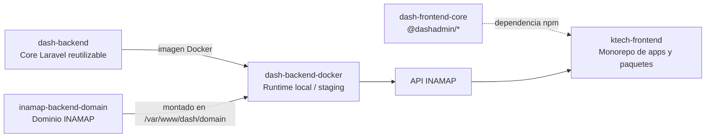

## 2.2 Repositorios involucrados

| Repo | Rol para INAMAP | ¿Se modifica? |
|---|---|---|
| `dash-backend` | Core: identidad, tenancy, planes, billing, mensajería | **No** (solo se consume) |
| `inamap-backend-domain` | **NUEVO.** Lógica de mapas, geometría, rutas, búsqueda | Sí (creado) |
| `dash-backend-docker` | Runtime: nuevos `.env.inamap*`, watcher, comandos rápidos | Sí (configuración) |
| `ktech-frontend` | Nuevas apps `inamap-*` y paquetes `im-*` | Sí |
| `dash-frontend-core` | Framework `dash-admin` publicado como `@dashadmin/*` | **No** |

## 2.3 Hallazgos verificados en el código (afectan el diseño)

| # | Hallazgo | Consecuencia para INAMAP |
|---|---|---|
| H1 | `config/app.php` registra `Domain\App\Providers\AppDomainServiceProvider` solo si la clase existe; el provider **extiende** `AppServiceProvider`. | El único artefacto obligatorio del dominio es ese provider. |
| H2 | `routes/api.php` del dominio es un cargador `glob('domain/routes/api/*.php')`. | Agregar archivos de rutas no requiere registro adicional. |
| H3 | El core carga automáticamente `domain/config/*.php`, `domain/resources/lang`, `domain/database/migrations` (y subcarpetas), y `domain-config-layers/*/`. | Config, traducciones y migraciones se "enchufan" por convención de carpeta. |
| H4 | `DatabaseSeeder` descubre `domain/database/seeders/<Carpeta>/<Clase>` como `Domain\Database\Seeders\<Carpeta>\<Clase>`. | Seeders de permisos/roles/datos demo sin tocar el core. |
| H5 | El `composer.json` del core define PSR-4 `Domain\App\…` y fusiona `domain/composer.json`. | Los namespaces de INAMAP son **idénticos** a los de VaneXa; solo cambia el repositorio. |
| H6 | `run-local-mac.sh` deriva `.env.<proyecto>` y espera `DOMAIN_PATH=../<proyecto>-backend-domain`. | `pnpm dash:start inamap local` funciona al crear los archivos de entorno. |
| H7 | El core referencia clases de VaneXa/KitchnTabs (`LabProject`, `AgentConfiguration`, `ECommerce\Product`, notificaciones, marketplaces) **siempre tras `class_exists`**. | INAMAP es seguro, pero la documentación del core sobrestima su neutralidad; no se debe depender de ello. |
| H8 | Existe una plantilla CRUD completa en `vanexa-backend-domain/app/Http/Controllers/API/Example/Todo/*` (Controller, Request, Resource, Filter, Policy, TrashController) + `routes/api/example.php`. | Es el patrón que replica **cada** recurso de INAMAP (extiende `ReactAdminBaseController`). |
| H9 | PostgreSQL corre como `postgres:latest` **sin PostGIS**. `pg_trgm` ya se usa en VaneXa. | Geometría en JSON + algoritmos en PHP; búsqueda difusa con `pg_trgm` (+ `unaccent`). |
| H10 | Puertos ocupados: kitchntabs `25000/25001/25432/25379/25025/25026/25010`; vanexa `25100/26001/25433/25388/25027/25028`. | INAMAP requiere un bloque nuevo sin colisión (§5.2). |
| H11 | `scripts/git-watcher.js` tiene `DOMAIN_REPOS` y `PROJECTS` codificados. | INAMAP no se auto-despliega en staging hasta registrarlo. |
| H12 | El core despacha `Domain\App\Jobs\Listeners\TenantProvisioningJob` solo si existe. | Punto de extensión para aprovisionar datos iniciales de un tenant nuevo (§3.7). |
| H13 | El frontend es pnpm + Turborepo: `apps/<x>-{app,web,system}` + `packages/<prefijo>-*`; `vx-lab` usa `tsup` con `bundle:false`, `exports` comodín y `typesVersions`. | Prefijo `im-*` para los paquetes de INAMAP; receta en el skill `frontend-new-package`. |

## 2.4 Qué se reutiliza del core (sin reimplementar)

| Capacidad | Mecanismo del core | Uso en INAMAP |
|---|---|---|
| Autenticación | Sanctum, login/refresh, `TrialRegistrationController` | Login y **registro de tenants** en `inamap-web` |
| Tenancy | `Tenancy`/`Tenant`, `TenancyContextService`, `TenantSwitcher` | Aislamiento por tenant, cambio de tenant del TenancyAdmin |
| Roles y permisos | Spatie + `PermissionSeeder`/`RoleSeeder` por JSON | Permisos `inamap.*` por rol |
| Planes y límites | `SubscriptionPlan`, `PlanLimitsService` | Límites de mapas/layouts/ubicaciones por plan |
| Mensajería | `AppNotificationBuilder`, Reverb, Horizon | Avisos (publicación, límites) — opcional v1 |
| Medios | Spatie MediaLibrary + `HandlesImageUploads` + `DashFileStorage` | Imagen de fondo de cada layout (skill `dashadmin-images`) |
| CRUD estándar | `ReactAdminBaseController` + `config('react-admin-methods')` | Todos los recursos administrables |

---

# PARTE 3 — Arquitectura backend: `inamap-backend-domain`

## 3.1 Integración core ↔ dominio

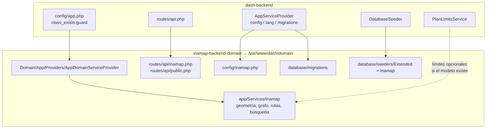

## 3.2 Estructura de carpetas del repositorio

```text
inamap-backend-domain/
├── composer.json                      # require: endroid/qr-code (QR de ubicaciones)
├── README.md
├── docs/
│   ├── ESPECIFICACION_TECNICA.md      # este documento
│   └── API.md
├── app/
│   ├── Providers/
│   │   ├── AppDomainServiceProvider.php
│   │   ├── AuthServiceProvider.php    # registra policies
│   │   └── CommandServiceProvider.php
│   ├── Models/
│   │   ├── Extended/{Tenant,User,Role}.php      # decoran modelos del core
│   │   └── Inamap/{Map,Layout,Zone,Structure,Category,Location,Path,PathLink}.php
│   ├── Http/
│   │   ├── Controllers/API/Inamap/
│   │   │   ├── Map/        {MapController,MapRequest,MapResource,MapFilter,MapPolicy}.php
│   │   │   ├── Layout/ Zone/ Structure/ Category/ Location/ Path/ PathLink/
│   │   │   └── Editor/LayoutGeometryController.php   # guardado atómico del layout
│   │   └── Controllers/API/Public/PublicMapController.php
│   ├── Services/Inamap/
│   │   ├── Geometry/{PolygonService,SegmentIntersection}.php
│   │   ├── Routing/{PathGraphBuilder,RouteService,EndpointResolver}.php
│   │   ├── Search/LocationSearchService.php
│   │   ├── Qr/LocationQrService.php
│   │   └── Diagnostics/MapConnectivityService.php
│   ├── Observers/{MapObserver,SearchableObserver,GraphInvalidationObserver}.php
│   ├── Jobs/Listeners/TenantProvisioningJob.php
│   └── Rules/{NoZoneOverlap,PolygonIsSimple,PointInsideLayout}.php
├── config/
│   ├── inamap.php                     # unidades, tolerancias, TTL de caché, límites
│   └── branding.php
├── database/
│   ├── migrations/
│   ├── seeders/{Extended,Inamap}/
│   ├── factories/
│   └── data/{permissions.json,rolePermissions/*.json}
├── routes/{api.php,api/inamap.php,api/public.php,channels.php,web.php}
├── resources/lang/{es,en}/
└── tests/Feature/API/Inamap/ , tests/Unit/Inamap/
```

> **Regla de oro:** el esqueleto es *mínimo*. Solo se replica la **convención** de carpetas y la plantilla CRUD `Example/Todo`.

## 3.3 Componentes y responsabilidades

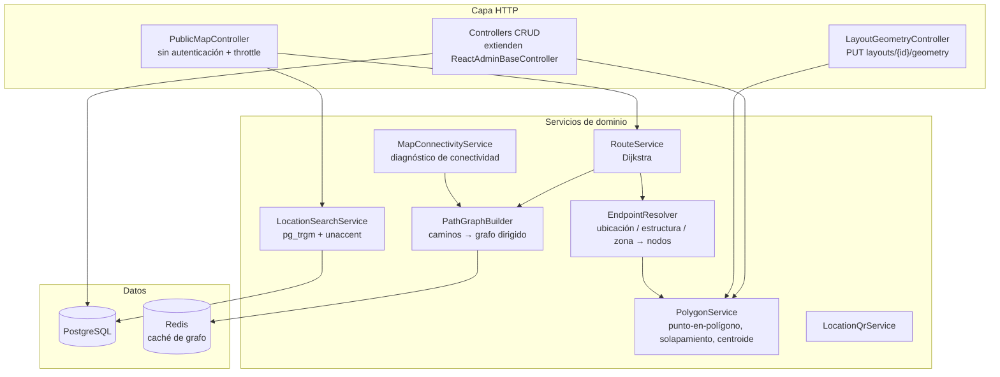

## 3.4 Modelo de coordenadas y geometría

| Decisión | Detalle | Motivo |
|---|---|---|
| Unidad | **Metros** (campo `unit` en el mapa, v1 fijo `m`) | Requerimiento: "el sistema inicialmente utilizará metros" |
| Plano | Cartesiano; origen `(0,0)` en la esquina **superior izquierda** del layout; `y` crece hacia abajo | Coincide con el canvas del navegador; evita inversiones de eje |
| Almacenamiento | La geometría se guarda en **metros**, nunca en píxeles | Cambiar/re-escalar la imagen de fondo no corrompe zonas ni caminos |
| Imagen ↔ plano | Cada layout define `width_m` y `height_m`; la imagen se estira a ese rectángulo | Un layout = un rectángulo en metros + imagen |
| Polígono | `json` `[[x,y],…]`, ≥ 3 vértices, simple (sin autointersección), orientación libre | Validado por la regla `PolygonIsSimple` |
| Camino | `json` `[[x,y],…]`, ≥ 2 vértices | Polilínea |
| Tolerancia | `inamap.snap_tolerance_m` (def. `0.30`) | Dos vértices a menos de la tolerancia se consideran el mismo nodo |
| Precisión | `decimal(10,3)` / floats redondeados a mm | Evita falsos "no conectado" por ruido numérico |

## 3.5 Motor de rutas

### Construcción del grafo (por mapa)

1. **Nodos:** cada vértice de cada camino. Vértices dentro de la tolerancia (incluso de caminos distintos) se **fusionan** en un solo nodo.
2. **Aristas intra-camino:** entre vértices consecutivos, con peso = distancia euclidiana (m). La **dirección** del camino filtra el sentido:
   - `forward` → solo del primer al último vértice;
   - `backward` → solo del último al primero;
   - `both` → ambos sentidos.
3. **Enlaces explícitos** (`inamap_path_links`): arista entre un extremo de un camino y un extremo de otro, aunque no coincidan geométricamente. `kind = link` (misma planta, línea punteada en la UI) o `kind = vertical` (entre layouts distintos: ascensor/escalera). Tienen `cost` opcional (penalización p. ej. ascensor = 15 m equivalentes).
4. **Caché:** el grafo serializado se guarda por mapa en Redis y se invalida con cualquier escritura en caminos, enlaces o layouts del mapa (`GraphInvalidationObserver`).

### Resolución de origen/destino (`EndpointResolver`)

| Tipo | Resolución |
|---|---|
| `location` | Se proyecta al punto más cercano de un camino del **mismo layout** (nodo virtual con aristas a los extremos del segmento, respetando dirección). |
| `structure` / `zone` | Fuente/sumidero **múltiple**: nodos del grafo que caen dentro del polígono o a ≤ tolerancia de su borde; si no hay, el nodo más cercano al centroide. El destino resultante es el de menor costo. |
| Sin camino cercano | Error tipificado `NO_PATH_NEAR_ENDPOINT` (y el diagnóstico lo reporta en el editor). |

### Búsqueda de ruta y respuesta

- Algoritmo: **Dijkstra** sobre grafo dirigido ponderado (escala esperada ≪ 10⁴ nodos; A* no justifica su complejidad).
- Respuesta JSON: `distance_m`, `estimated_seconds` (a 1.2 m/s, configurable), y `steps[]` donde cada paso es **un tramo por layout**: `{layout_id, layout_name, points[], distance_m, transition?: {kind:'vertical', to_layout_id}}`.
- Errores tipificados: `UNREACHABLE`, `NO_PATH_NEAR_ENDPOINT`, `ENDPOINT_NOT_FOUND`, `MAP_NOT_PUBLISHED`.

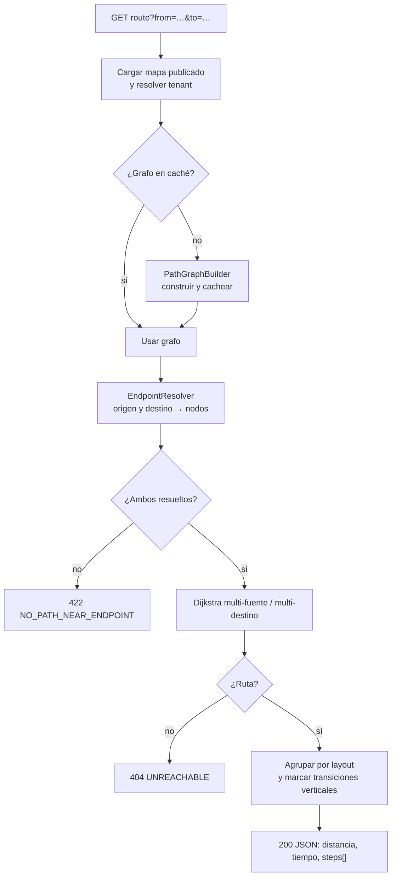

## 3.6 Seguridad, permisos y aislamiento

**Aislamiento por tenant.** Todas las tablas de negocio llevan `tenant_id`. Los controladores heredan el *scoping* del `ReactAdminBaseController`; las consultas del endpoint público resuelven el tenant **desde el mapa** (`public_id`), nunca desde parámetros del cliente.

**Permisos.** Convención `route_name` del framework (`api.inamap.<entidad>.<acción>`), sembrados con JSON (primera vez) y, para cambios posteriores, `PermissionMigration` (skill `dashadmin-permissions`).

| Recurso | SystemAdmin | TenancyAdmin | TenantAdmin | Editor | Visitante |
|---|---|---|---|---|---|
| Mapas (CRUD) | ✔ | ✔ (sus tenants) | ✔ | Leer / editar | — |
| Publicar / despublicar mapa | ✔ | ✔ | ✔ | — | — |
| Layouts (CRUD + imagen) | ✔ | ✔ | ✔ | ✔ | — |
| Zonas / estructuras / ubicaciones / caminos / enlaces | ✔ | ✔ | ✔ | ✔ | — |
| Categorías | ✔ | ✔ | ✔ | Leer | — |
| Diagnóstico de conectividad / QR | ✔ | ✔ | ✔ | ✔ | — |
| API pública (mapa, búsqueda, ruta) | — | — | — | — | ✔ (solo mapas publicados) |
| Tenancies, tenants, usuarios, planes | ✔ | ✔ (su alcance) | Tenant propio | — | — |

**API pública:** sin autenticación, `throttle` configurable por IP y por mapa, solo `status=published`, IDs públicos UUID (no secuenciales), CORS administrado con `domain-config-layers`, cabeceras `Cache-Control`/`ETag` para el payload del mapa.

## 3.7 Aprovisionamiento y límites de plan

- **`TenantProvisioningJob`** (listener del core, H12): al crearse un tenant, siembra categorías por defecto (Baños, Accesos, Servicios, Salidas de emergencia, Información) y, opcionalmente, un mapa de ejemplo.
- **Límites de plan** (JSON del `SubscriptionPlan`, `0/null/-1` = ilimitado, SystemAdmin exento): `max_maps`, `max_layouts_per_map`, `max_locations`, `max_public_requests_per_day` (v2). Se consultan con `PlanLimitsService` antes de crear el recurso; el core ya tolera modelos de dominio ausentes.

## 3.8 Estrategia de pruebas (backend)

| Nivel | Qué cubre |
|---|---|
| Unitarias | `PolygonService` (contención, solapamiento, borde compartido permitido), `RouteService` (sentido único, enlace vertical, inalcanzable), `PathGraphBuilder` (fusión por tolerancia) |
| Feature | CRUD por entidad con aislamiento entre tenants; regla de no-solapamiento (422); guardado atómico de layout (todo o nada); permisos por rol; límites de plan |
| API pública | Mapa no publicado → 404; mapa de otro tenant inaccesible; búsqueda difusa (acentos, typos); ruta entre layouts; throttle |
| Regresión de core | `--testsuite Core` sin cambios (el dominio no debe romper el core) |

---

# PARTE 4 — Arquitectura frontend

## 4.1 Mapa de aplicaciones (patrón VaneXa: system / web / app)

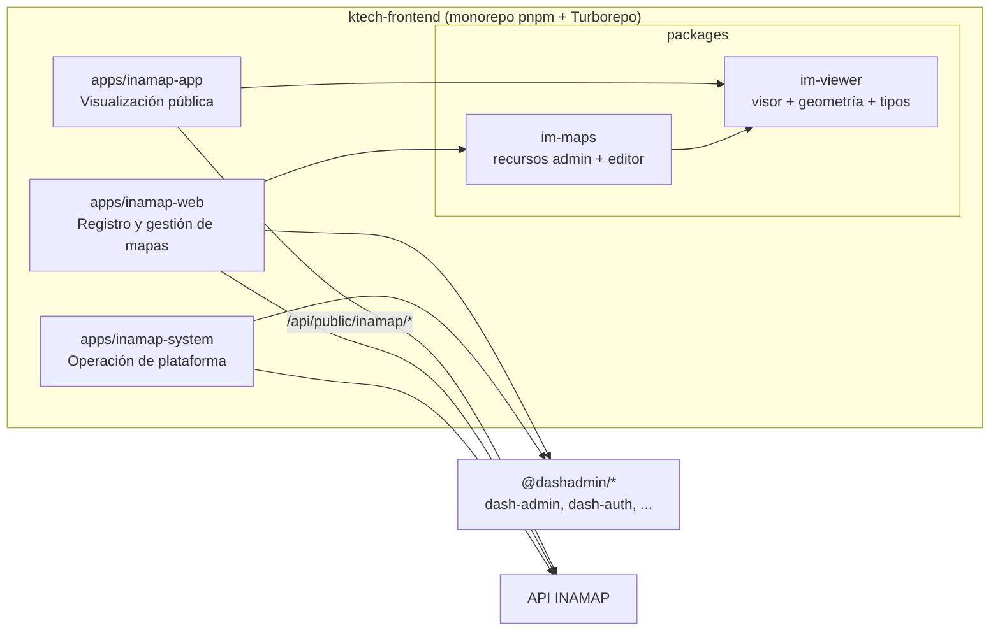

| App | Audiencia | Propósito | Autenticación | Contenido |
|---|---|---|---|---|
| **`inamap-system`** | Administrador de sistema | Funciones de **gestión de tenancy** y operación de la plataforma | Sí (`SystemAdmin`) | Tenancies, tenants, usuarios, roles/permisos, planes de suscripción y límites, pasarelas de pago, auditoría/logs, estadísticas globales |
| **`inamap-web`** | Clientes (tenants) y sus equipos | **Registro** de tenants y **gestión de mapas** | Sí (`TenantAdmin`, `TenancyAdmin`, Editor) + registro público | Registro/trial, onboarding, mapas, layouts, editor de canvas, categorías, usuarios del tenant, publicación, QR, plan/suscripción |
| **`inamap-app`** | Visitantes | **Servir los mapas** al usuario final | No (público) | Visor de mapa, búsqueda, selector origen/destino, ruta animada, cambio de piso, ficha de ubicación |

> **Diferencia deliberada con VaneXa:** allí `vanexa-app` es la app autenticada del tenant. En INAMAP el rol de "app" es **público y ligero**; la gestión autenticada vive en `inamap-web`. Por eso el visor se separa en un paquete sin dependencia de `react-admin` (`im-viewer`).

## 4.2 Paquetes de dominio `im-*`

| Paquete | Dependencias clave | Contenido |
|---|---|---|
| **`im-viewer`** | React, MUI (mínimo). **Sin** `react-admin` | `MapViewer`, `RouteLayer`, `LayoutSwitcher`, `SearchBox` (autocompletado difuso), `LocationCard`, tipos y utilidades de geometría, cliente de la API pública, i18n propio |
| **`im-maps`** | `react-admin`, `dash-admin`, `im-viewer` | Recursos (`mapResource`, `layoutResource`, `categoryResource`, listados de zonas/estructuras/ubicaciones/caminos), **`MapEditorCanvas`**, paneles de metadata, formularios, hooks, i18n |

Ambos siguen la receta `frontend-new-package`: `tsup` con `bundle:false`, mapa `exports` comodín + `typesVersions`, sin re-declarar dependencias del workspace, traducciones registradas de forma progresiva (`dashadmin-i18n`), y *source-aliasing* automático en desarrollo (`localPackageSrcAliases.mts`).

## 4.3 Editor de canvas (`MapEditorCanvas`)

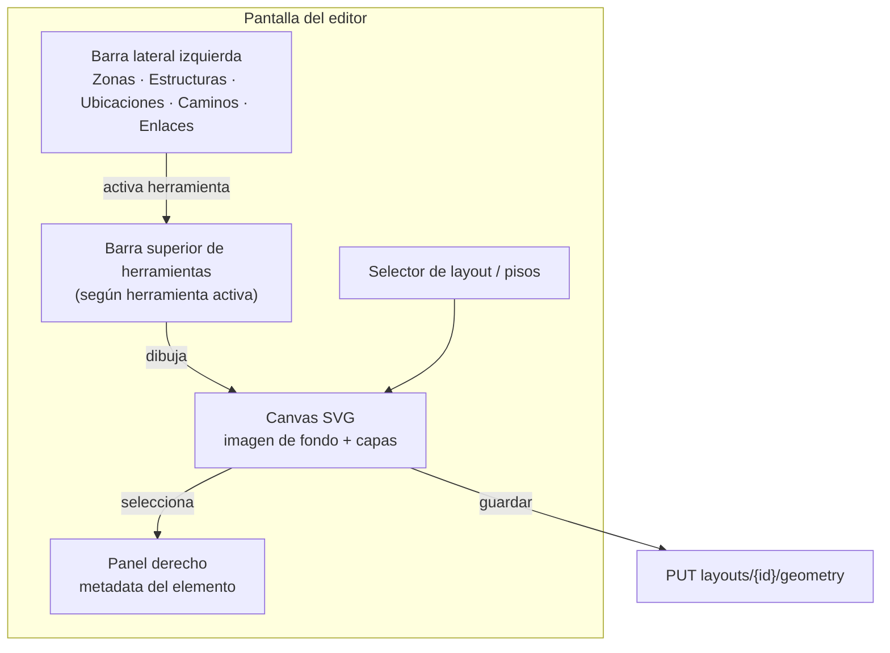

- **Render:** SVG (suficiente para polígonos/polilíneas de este volumen; animación de ruta trivial). Decisión revisable si se superan ~5 000 elementos por layout.
- **Capas (z-order):** imagen de fondo → zonas (translúcidas) → estructuras (sólidas) → caminos → ubicaciones → ruta calculada.
- **Herramientas:** *Zona* y *Estructura* (dibujo de polígono, edición de vértices, color y etiqueta), *Ubicación* (clic sobre el plano, ícono, metadata), *Camino* (polilínea, sentido), *Enlace* (arrastrar entre extremos; línea punteada), *Medir*.
- **Validación en vivo:** el solapamiento de zonas se resalta en rojo en cliente; la validación **autoritativa** es la del servidor (422).
- **Estado:** el editor trabaja sobre un documento de layout en memoria con deshacer/rehacer; el guardado es atómico (§3.5 / §9).
- **Diagnóstico:** botón "Verificar conectividad" muestra ubicaciones inalcanzables y caminos sueltos.

## 4.4 Visor público (`MapViewer`)

- Carga el payload del mapa publicado una vez; búsqueda y ruta se piden bajo demanda.
- Campos **Origen** y **Destino** con autocompletado difuso (zonas, estructuras, ubicaciones de cualquier layout); filtro por categoría.
- Dibuja la ruta por layout, con control para pasar de piso al llegar a un enlace vertical.
- Modo *embebible*: `<iframe src="…/embed/{publicId}">` o *web component* (evolución); ficha con QR y enlace.

## 4.5 Patrones del framework que se mantienen

| Patrón | Aplicación en INAMAP |
|---|---|
| **Manifiesto de recursos** (`ResourceManifest` + `loadResourcesFromManifest`) | Cada app lazy-load de sus recursos; `inamap-web` separa manifiesto *tenancy-level* y *tenant-level* como `vanexa-web`. |
| **TenantSwitcher** | `TenancyAdmin` cambia de tenant en `inamap-web`; persiste `last_active_tenant_id` vía `TenancyContextService`. |
| **Constantes por app** | Cada app tiene su `.env` y `FRONTEND_URL` propios (skill `dash-admin-envs-constants`): atención a URLs cruzadas (el QR apunta a `inamap-app`). |
| **Formularios** | `DashAutoForm`/Resource+Schema (skill `dashadmin-forms`); subida de imagen con `ImageInput` (skill `dashadmin-images`). |
| **i18n** | `es` primario, `en` secundario; claves en el paquete dueño de las cadenas. |
| **Dependencia publicada** | `@dashadmin/*` se consume por npm, no por enlace de workspace; `LINK_DASH_CORE=true` solo para desarrollo del framework. |

## 4.6 Configuración de build y scripts (a replicar de VaneXa)

- `build_config.inamap-{app,web,system}.json` y `inamap-*.{development,staging,production}.config.json` por app.
- Scripts raíz: `config:web:inamap-<app>:<modo>`, `tunnel:web:inamap-<app>[:staging]`, `dev-im-app`, `dev-im-web`, `dev-im-system`.
- `vite.config.mts` por app con `define` de variables `VITE_*` y alias de paquetes locales.

---

# PARTE 5 — Runtime, entornos y despliegue

## 5.1 Topología local

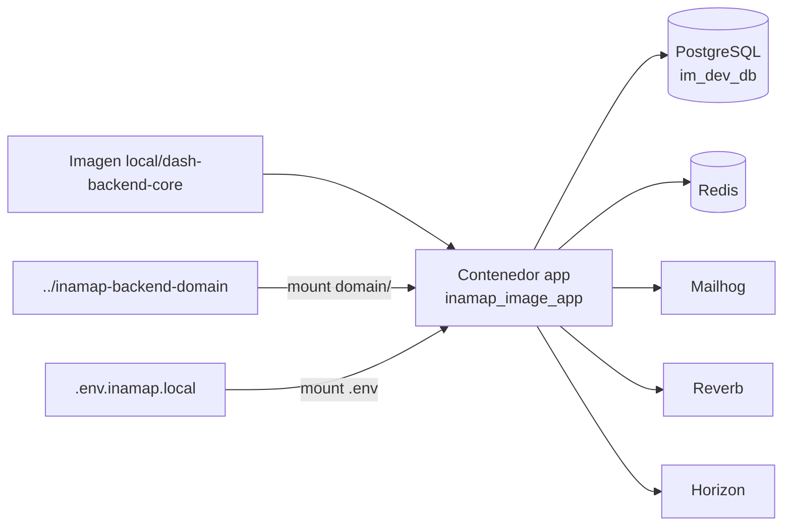

## 5.2 Parámetros del proyecto en `dash-backend-docker`

| Parámetro | Proyecto base | Proyecto alterno | **inamap (propuesto)** |
|---|---|---|---|
| Archivo compose | `.env.<proyecto-base>` | `.env.<proyecto-alterno>` | **`.env.inamap`** |
| `COMPOSE_PROJECT_NAME` | `dash_image` | `project_image` | **`inamap_image`** |
| `DOMAIN_PATH` | `../<dominio-base>` | `../<dominio-alterno>` | **`../inamap-backend-domain`** |
| API local | 25000 | 25100 | **25200** |
| Reverb | 25001 | 26001 | **27001** |
| PostgreSQL | 25432 | 25433 | **25434** |
| Redis | 25379 | 25388 | **25389** |
| Mailhog SMTP / UI | 25025 / 25026 | 25027 / 25028 | **25029 / 25030** |
| API Docs | 25010 | — | **25011** |
| DB / usuario | `db_dev` / `user` | `db_dev_alt` / `user_alt` | **`im_dev_db` / `im`** |
| `STORAGE_PATH` | `./storage/<dominio-base>` | `./storage/<dominio-alterno>` | **`./storage/inamap-backend-domain`** |

> Los puertos son una propuesta; se confirman contra los `.env.*` existentes al implementar. Nunca se reutilizan secretos (`APP_KEY`, claves de terceros) de otros proyectos.

## 5.3 Cambios de configuración (sin tocar `docker-compose.yml`)

1. Crear `.env.inamap` y `.env.inamap.local` (y luego `.development`, `.staging` según necesidad).
2. `scripts/git-watcher.js`: agregar `{ name:'inamap-backend-domain', path:'../inamap-backend-domain', project:'inamap' }` a `DOMAIN_REPOS` y `'inamap'` a `PROJECTS`.
3. `QUICK_COMMANDS.md`: columna/filas para inamap.
4. `domain-config-layers/` (opcional): `10-inamap/cors.php` para el origen del visor/embeds.

Arranque: `pnpm dash:start inamap local`. Regla vigente: **nunca** `migrate:fresh`/`db:wipe` en el entorno de desarrollo; solo `php artisan migrate`.

## 5.4 Despliegue (fuera de v1)

Producción replicará el patrón `project-ci-cdk` (ECS Fargate + ALB + RDS + Valkey, imagen core + dominio horneado). Se especificará en un documento separado (`inamap-ci-cdk`). No está detro del alcance el despliegue escalable a producción en esta etapa.

---

# PARTE 6 — Requerimientos funcionales e historias de usuario

## 6.1 Requerimientos funcionales

### Gestión de mapas y layouts
| ID | Requerimiento |
|---|---|
| RF-01 | El sistema debe permitir crear, editar, listar y eliminar **mapas**, cada uno asociado a un sistema de coordenadas en metros. |
| RF-02 | Un mapa debe poder contener **múltiples layouts** (p. ej. pisos), ordenables por nivel. |
| RF-03 | Cada layout debe permitir **subir una imagen de fondo propia** y definir sus dimensiones reales (`width_m`, `height_m`). |
| RF-04 | El mapa debe tener estado **borrador/publicado**; solo los publicados son visibles en la API pública. |

### Geometría
| ID | Requerimiento |
|---|---|
| RF-05 | El sistema debe permitir administrar **zonas**: polígonos sobre el layout con color, etiqueta y código. |
| RF-06 | Las zonas **no pueden solaparse** dentro del mismo layout (borde compartido permitido). |
| RF-07 | El sistema debe permitir administrar **estructuras**: polígonos de superficie sólida con color, etiqueta y código (edificios, pabellones). |
| RF-08 | Una estructura puede **contener ubicaciones**. |
| RF-09 | El sistema debe permitir administrar **ubicaciones**: punto en el plano con etiqueta, código, ícono, categoría, metadata y **código QR** que enlaza a un sitio web. |
| RF-10 | Zonas, estructuras y ubicaciones deben admitir **términos de búsqueda** (`terms`) en su metadata. |
| RF-11 | El sistema debe permitir administrar **categorías** y asignar una a cada ubicación. |

### Caminos y rutas
| ID | Requerimiento |
|---|---|
| RF-12 | El sistema debe permitir dibujar **caminos** como polilíneas libres sobre el layout. |
| RF-13 | Cada camino debe tener **dirección** de circulación (`forward`, `backward`, `both`). |
| RF-14 | Los caminos pueden conectarse por **vértices coincidentes** o por **enlaces explícitos** (línea punteada en la UI). |
| RF-15 | Un camino puede enlazarse con otro de **otro layout** (ascensor/escalera). |
| RF-16 | El sistema debe **calcular la ruta óptima** entre origen y destino respetando las direcciones. |
| RF-17 | Origen y destino pueden ser **ubicación, estructura o zona**, en cualquier layout. |
| RF-18 | El sistema debe ofrecer un **diagnóstico de conectividad** que identifique ubicaciones inalcanzables y caminos aislados. |

### Búsqueda y API pública
| ID | Requerimiento |
|---|---|
| RF-19 | El sistema debe ofrecer **búsqueda difusa** por términos libres sobre etiquetas, códigos, términos, categoría y metadata, devolviendo el tipo (zona/estructura/ubicación). |
| RF-20 | La búsqueda debe poder **filtrarse por categoría**. |
| RF-21 | La API debe responder en **JSON**. |
| RF-22 | Debe existir un **endpoint público** del mapa para desplegar un visor HTML con zonas, estructuras y ubicaciones sobre la imagen de fondo, con indicaciones A→B. |

### Plataforma (reuso del core)
| ID | Requerimiento |
|---|---|
| RF-23 | Un cliente debe poder **registrarse** (trial) y obtener su tenant en `inamap-web`. |
| RF-24 | El administrador de tenant debe gestionar **usuarios del tenant** y sus roles. |
| RF-25 | El administrador de tenancy debe **cambiar de tenant** y administrar varios. |
| RF-26 | El administrador de sistema debe gestionar **tenancies, tenants, planes y límites** en `inamap-system`. |
| RF-27 | El sistema debe hacer cumplir los **límites del plan** (mapas, layouts, ubicaciones). |
| RF-28 | El editor debe **guardar un layout de forma atómica** (zonas, estructuras, ubicaciones y caminos en una sola transacción). |

## 6.2 Historias de usuario

### Visitante (`inamap-app`)
| ID | Historia | Criterios de aceptación |
|---|---|---|
| HU-VIS-01 | Como visitante quiero abrir un mapa por su enlace/QR para orientarme en el recinto. | El mapa publicado carga con imagen, zonas, estructuras y ubicaciones. Un mapa no publicado responde "no disponible". |
| HU-VIS-02 | Como visitante quiero buscar un lugar escribiendo términos libres. | Tolera acentos y errores menores; muestra tipo y layout del resultado; vacío muestra "sin resultados". |
| HU-VIS-03 | Como visitante quiero filtrar la búsqueda por categoría (baños, accesos…). | El filtro limita resultados; combinable con texto. |
| HU-VIS-04 | Como visitante quiero elegir origen y destino y ver la ruta dibujada. | La ruta se muestra sobre el plano con distancia y tiempo estimado; respeta sentidos únicos. |
| HU-VIS-05 | Como visitante quiero que la ruta me indique cuando cambio de piso. | La ruta se divide por layout; hay botón para pasar al siguiente tramo; se indica ascensor/escalera. |
| HU-VIS-06 | Como visitante quiero ver la ficha de una ubicación (nombre, categoría, enlace). | Ficha con metadata y botón "cómo llegar" que usa la ubicación como destino. |
| HU-VIS-07 | Como visitante quiero usar origen = zona o estructura. | La ruta se calcula hasta el borde/accesos del polígono. |
| HU-VIS-08 | Como visitante quiero que me avisen si no hay ruta. | Mensaje claro "no hay ruta disponible" sin error técnico. |
| HU-VIS-09 | Como visitante quiero escanear un QR de una ubicación y llegar a su sitio web. | El QR apunta a la URL configurada. |

### Editor de mapas (`inamap-web`)
| ID | Historia | Criterios de aceptación |
|---|---|---|
| HU-EDI-01 | Como editor quiero subir la imagen de fondo de un layout. | Se acepta JPG/PNG/WebP con tamaño máx.; se previsualiza; se puede reemplazar sin perder geometría. |
| HU-EDI-02 | Como editor quiero dibujar zonas con color y etiqueta. | El polígono se cierra con ≥ 3 vértices; editable; color y código persistentes. |
| HU-EDI-03 | Como editor quiero que el sistema impida zonas solapadas. | Al solapar, se resalta y el guardado devuelve 422 con las zonas en conflicto. |
| HU-EDI-04 | Como editor quiero dibujar estructuras sólidas. | Igual que zonas, con relleno sólido y color. |
| HU-EDI-05 | Como editor quiero insertar ubicaciones con clic en el plano. | Aparece ícono; el panel derecho edita etiqueta, código, categoría, ícono, términos y URL. |
| HU-EDI-06 | Como editor quiero asignar una ubicación a una estructura. | Selector de estructura; filtra por layout. |
| HU-EDI-07 | Como editor quiero dibujar caminos y definir su sentido. | Polilínea con flechas de dirección; cambio de sentido inmediato. |
| HU-EDI-08 | Como editor quiero unir caminos con un enlace cuando no se tocan. | Se muestra línea punteada; el enlace se usa en el cálculo de rutas. |
| HU-EDI-09 | Como editor quiero unir un camino con otro layout (ascensor). | Selector de layout y camino destino; marca `vertical` con costo opcional. |
| HU-EDI-10 | Como editor quiero verificar la conectividad de mi mapa. | Lista ubicaciones inalcanzables y caminos aislados con navegación al elemento. |
| HU-EDI-11 | Como editor quiero probar una ruta antes de publicar. | Vista previa autenticada sobre mapa en borrador. |
| HU-EDI-12 | Como editor quiero deshacer/rehacer y guardar todo de una vez. | Guardado atómico; si falla nada se aplica. |
| HU-EDI-13 | Como editor quiero generar e imprimir el QR de una ubicación. | Descarga PNG/SVG con la URL del visor. |
| HU-EDI-14 | Como editor quiero importar/duplicar un mapa o layout *(evolución)*. | Marcado como backlog (§10.4). |

### Administrador de tenant (`inamap-web`)
| ID | Historia | Criterios de aceptación |
|---|---|---|
| HU-TEN-01 | Como cliente quiero registrarme y crear mi cuenta. | Flujo trial del core; verificación de correo; tenant y usuario administrador creados. |
| HU-TEN-02 | Como administrador quiero crear mapas y layouts dentro de mi plan. | Se bloquea con mensaje claro al exceder `max_maps`/`max_layouts_per_map`. |
| HU-TEN-03 | Como administrador quiero publicar/despublicar un mapa. | Cambia el estado; el enlace público refleja el cambio inmediato. |
| HU-TEN-04 | Como administrador quiero obtener el enlace y el código para embeber el visor. | Muestra URL pública, QR del mapa e `iframe` listo para copiar. |
| HU-TEN-05 | Como administrador quiero gestionar categorías. | CRUD; no se elimina una categoría en uso sin reasignar. |
| HU-TEN-06 | Como administrador quiero gestionar usuarios de mi tenant y sus permisos. | Crea editores con permisos acotados. |
| HU-TEN-07 | Como administrador quiero ver y cambiar mi plan. | Ve uso vs. límites; flujo de suscripción del core. |
| HU-TEN-08 | Como administrador quiero configurar la marca (logo, colores) del visor. | Colores/logo del tenant aplicados al visor público. |

### Administrador de tenancy (`inamap-web`)
| ID | Historia | Criterios de aceptación |
|---|---|---|
| HU-TCY-01 | Como administrador de tenancy quiero crear y administrar varios tenants. | Respeta `max_tenants` del plan. |
| HU-TCY-02 | Como administrador de tenancy quiero cambiar entre tenants. | `TenantSwitcher`; la preferencia persiste entre dispositivos. |
| HU-TCY-03 | Como administrador de tenancy quiero ver los mapas de cualquiera de mis tenants. | Al cambiar de tenant se carga el manifiesto tenant-level. |

### Administrador de sistema (`inamap-system`)
| ID | Historia | Criterios de aceptación |
|---|---|---|
| HU-SYS-01 | Como administrador de sistema quiero gestionar tenancies y tenants. | CRUD completo con suspensión/reactivación. |
| HU-SYS-02 | Como administrador de sistema quiero definir planes y sus límites INAMAP. | Edita `max_maps`, `max_layouts_per_map`, `max_locations`. |
| HU-SYS-03 | Como administrador de sistema quiero gestionar usuarios, roles y permisos. | Catálogo `inamap.*` visible y asignable. |
| HU-SYS-04 | Como administrador de sistema quiero configurar pasarelas de pago. | Reuso del core (Rebill/Flow). |
| HU-SYS-05 | Como administrador de sistema quiero auditar cambios y ver logs. | Bitácora del core (usuario, acción, entidad). |
| HU-SYS-06 | Como administrador de sistema quiero ver estadísticas globales (mapas, ubicaciones, consultas). | Tablero con totales por tenancy. |

## 6.3 Matriz de trazabilidad (resumen)

| Historias | RF | App | Endpoint principal |
|---|---|---|---|
| HU-VIS-01/06/09 | RF-09, RF-22 | app | `GET public/inamap/maps/{publicId}` |
| HU-VIS-02/03 | RF-19, RF-20 | app | `GET public/inamap/maps/{id}/search` |
| HU-VIS-04/05/07/08 | RF-16, RF-17 | app | `GET public/inamap/maps/{id}/route` |
| HU-EDI-01/02/04/05/07 | RF-03, RF-05, RF-07, RF-09, RF-12/13 | web | `PUT layouts/{id}/geometry` |
| HU-EDI-03 | RF-06 | web | `PUT layouts/{id}/geometry` → 422 |
| HU-EDI-08/09 | RF-14, RF-15 | web | CRUD `path-links` |
| HU-EDI-10 | RF-18 | web | `GET maps/{id}/connectivity` |
| HU-TEN-01 | RF-23 | web | registro del core |
| HU-TEN-02 | RF-27 | web | CRUD `maps` + `PlanLimitsService` |
| HU-TEN-03 | RF-04 | web | `POST maps/{id}/publish` |
| HU-TCY-* | RF-25 | web | `PUT auth/active-tenant` (core) |
| HU-SYS-* | RF-26 | system | recursos del core |

---

# PARTE 7 — Modelo de datos (diagramas ER)

## ER-01 — Modelo de plataforma y dominio (visión general)

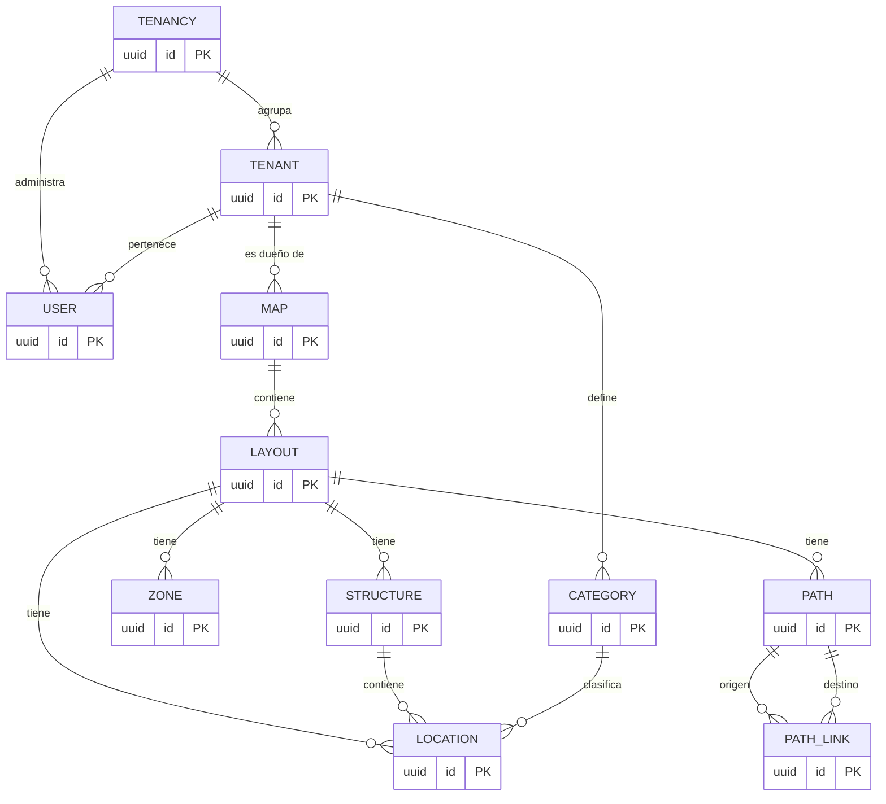

## ER-02 — Modelo funcional detallado del dominio

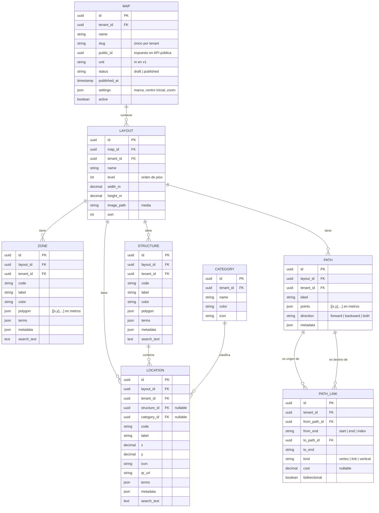

> Todas las tablas son prefijadas `inamap_` en base de datos (`inamap_maps`, `inamap_layouts`, …) para evitar colisiones con el core. Eliminación **lógica** (`deleted_at`) en todas. Los índices `gin (search_text gin_trgm_ops)` aplican a zonas, estructuras y ubicaciones; índices compuestos `(tenant_id, map_id)`, `(layout_id)`, `(tenant_id, slug)` único.

## ER-03 — Modelo conceptual del grafo de rutas (derivado, no persistido)

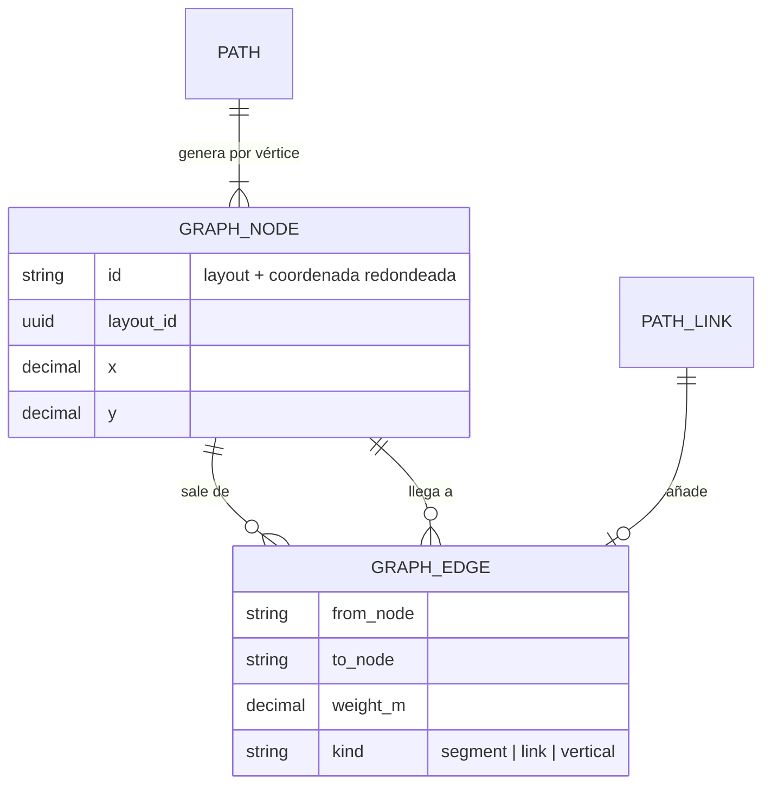

## 7.4 Reglas de integridad

| Regla | Dónde se aplica |
|---|---|
| Zonas de un mismo layout no se solapan (borde compartido permitido) | `NoZoneOverlap` en request + guardado atómico |
| Polígonos simples y con ≥ 3 vértices; caminos con ≥ 2 | `PolygonIsSimple` / validación de longitud |
| Geometría dentro de `[0,width_m]×[0,height_m]` | `PointInsideLayout` (advertencia si el layout cambia de tamaño) |
| Un `PATH_LINK` `vertical` une caminos de **layouts distintos del mismo mapa** | `PathLinkRequest` |
| Un enlace no puede unir caminos de mapas o tenants distintos | `PathLinkRequest` + scoping |
| `slug` único por tenant; `public_id` único global | Índices únicos |
| Eliminar categoría en uso requiere reasignación | `CategoryPolicy`/controlador |
| Cualquier escritura en geometría invalida el grafo en caché | `GraphInvalidationObserver` |

---

# PARTE 8 — Flujos de usuario y de sistema

## FL-01 — Registro de un cliente y primer mapa

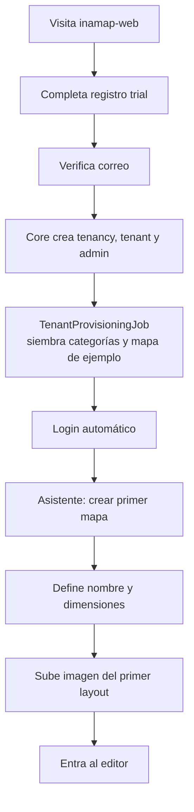

## FL-02 — Modelado de un layout en el editor

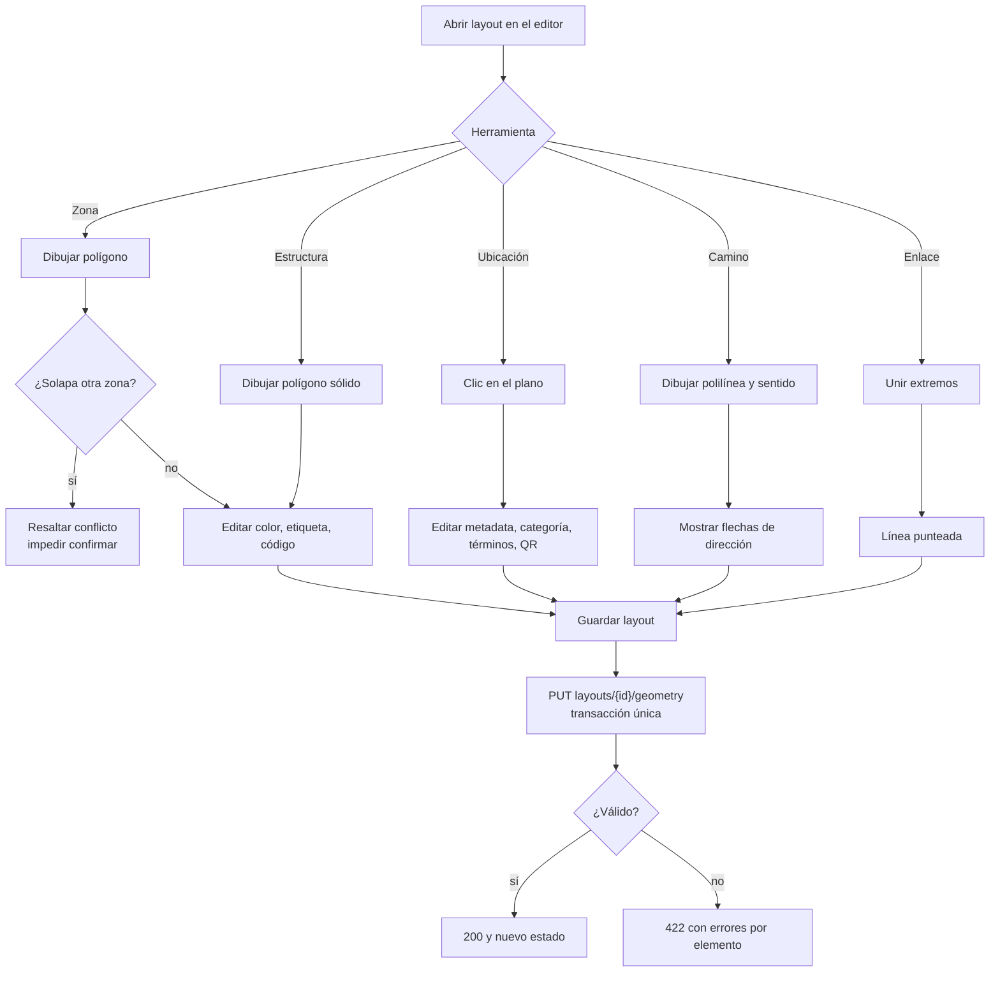

## FL-03 — Conexión entre pisos (ascensor)

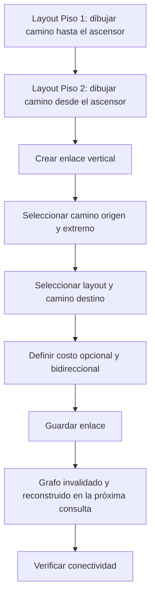

## FL-04 — Publicación de un mapa

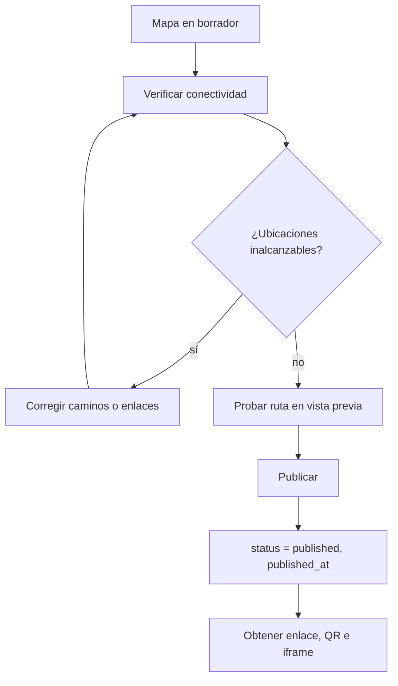

## FL-05 — El visitante busca y obtiene una ruta

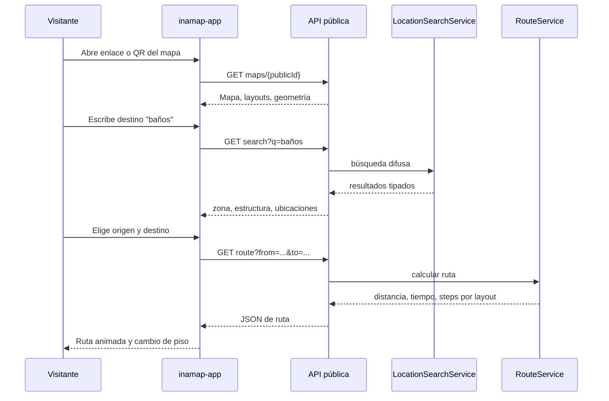

## FL-06 — Cambio de tenant de un administrador de tenancy

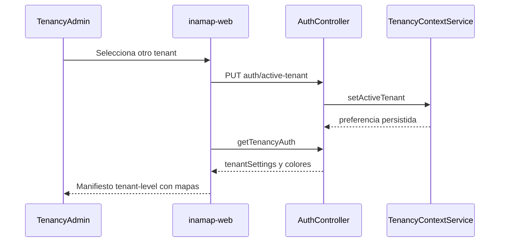

## FL-07 — Gestión de tenancies y planes (sistema)

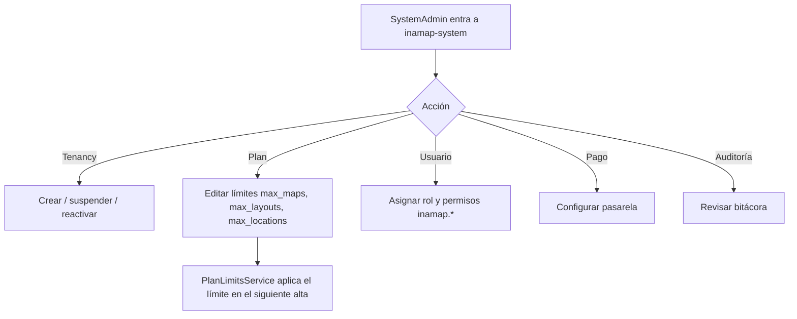

## FL-08 — Aplicación de límites de plan

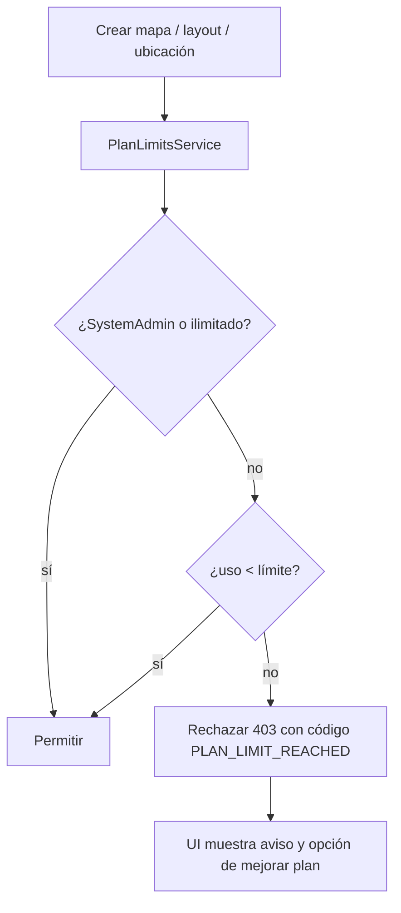

---

# PARTE 9 — Catálogo de API

Prefijos: autenticadas `api/inamap/*` (Sanctum, `ControllerOptions` y permisos por `route_name`); públicas `api/public/inamap/*`.

## 9.1 Autenticadas

| Método y ruta | Descripción | `route_name` |
|---|---|---|
| CRUD estándar `maps`, `layouts`, `zones`, `structures`, `locations`, `categories`, `paths`, `path-links` | Conjunto `react-admin-methods` (getList, getOne, create, update, delete, deleteMany, getForSelect, filterValue/s) | `api.inamap.<entidad>.*` |
| `POST maps/{id}/publish` · `POST maps/{id}/unpublish` | Cambia el estado de publicación | `api.inamap.map.publish` |
| `POST layouts/{id}/image` | Sube/reemplaza imagen de fondo | `api.inamap.layout.image` |
| `PUT layouts/{id}/geometry` | Guardado atómico de zonas, estructuras, ubicaciones y caminos | `api.inamap.layout.geometry` |
| `GET maps/{id}/connectivity` | Diagnóstico de conectividad | `api.inamap.map.connectivity` |
| `GET maps/{id}/route` | Ruta de prueba (incluye borradores) | `api.inamap.map.route` |
| `GET locations/{id}/qr` | QR (PNG/SVG) de una ubicación | `api.inamap.location.qr` |

## 9.2 Públicas

| Método y ruta | Parámetros | Respuesta |
|---|---|---|
| `GET maps/{publicId}` | — | Mapa + layouts + zonas + estructuras + ubicaciones + categorías (+ caminos opcionales con `?include=paths`) |
| `GET maps/{publicId}/search` | `q`, `category?`, `layout?`, `limit?` | `[{type, id, label, code, layout_id, category, score}]` |
| `GET maps/{publicId}/route` | `from=<type>:<id>`, `to=<type>:<id>` | `{distance_m, estimated_seconds, steps[]}` o error tipificado |
| `GET maps/{publicId}/locations/{id}` | — | Ficha de una ubicación |

**Contrato de error:** `{ "error": { "code": "UNREACHABLE", "message": "…" } }` con códigos HTTP 404/422/429.

---

# PARTE 10 — No funcionales, riesgos, supuestos y entrega

## 10.1 Requerimientos no funcionales

| ID | Requerimiento | Meta |
|---|---|---|
| RNF-01 | Aislamiento multi-tenant en todas las consultas | 0 fugas entre tenants (pruebas obligatorias) |
| RNF-02 | Latencia de búsqueda | p95 < 300 ms con 10 000 elementos por mapa |
| RNF-03 | Latencia de ruta | p95 < 500 ms con grafo de 5 000 nodos (grafo cacheado) |
| RNF-04 | Disponibilidad de API pública | Coherente con el SLA de la plataforma; caché HTTP en el payload del mapa |
| RNF-05 | Protección de endpoints públicos | `throttle` por IP y mapa; sin datos de otros tenants; IDs no secuenciales |
| RNF-06 | Internacionalización | `es` (principal) y `en` en backend, editor y visor |
| RNF-07 | Accesibilidad del visor | WCAG 2.1 AA: teclado, contraste, texto alternativo |
| RNF-08 | Responsive | Visor usable en móvil (primario) y escritorio; editor en escritorio/tablet |
| RNF-09 | Auditoría | Cambios de geometría registrados con el sistema de auditoría del core |
| RNF-10 | Calidad | Pruebas unitarias/feature definidas en §3.8; `--testsuite Core` verde |
| RNF-11 | Documentación | Toda en español; API en OpenAPI/Postman bajo `routes/postman` |
| RNF-12 | Mantenibilidad | Cumplir frontera core/dominio: cero cambios en `dash-backend` |

## 10.2 Riesgos

| Riesgo | Impacto | Mitigación |
|---|---|---|
| Sin PostGIS: algoritmos geométricos propios | Errores en casos borde (polígonos degenerados) | Servicio aislado con batería de pruebas unitarias; librería probada si hace falta (`brick/geo` / `geoPHP`) evaluada en la Fase 3 |
| Grafo desconectado por dibujo impreciso | Rutas "inalcanzables" frustrantes | Tolerancia de unión + diagnóstico de conectividad + auto-"snap" en el editor |
| Mapas grandes degradan el editor SVG | UX lenta | Medir; migrar a canvas/WebGL solo si se superan los umbrales |
| Edición sobre mapa publicado afecta a visitantes en vivo | Rutas inconsistentes | v1: aviso en UI; evolución: publicación por *snapshot* (§10.4) |
| Colisión de puertos/secretos con otros proyectos | Stack no levanta o mezcla datos | Bloque de puertos propio; `APP_KEY` y credenciales nuevas |
| Acoplamiento accidental del core a INAMAP | Rompe otros dominios | Prohibido modificar `dash-backend`; revisión en PR |

## 10.3 Supuestos y preguntas abiertas

| # | Supuesto adoptado | A confirmar |
|---|---|---|
| S1 | Estructuras **pueden** solaparse con zonas (capas distintas); solapamiento estructura-estructura emite **advertencia**, no bloquea. | ¿Debe bloquearse? |
| S2 | Unidad fija en metros en v1. | ¿Se requiere configurable (pies)? |
| S3 | Velocidad peatonal 1.2 m/s para tiempo estimado. | ¿Valor distinto / accesibilidad (silla de ruedas)? |
| S4 | El visor público es de **solo lectura**; sin cuentas de visitante. | ¿Se requieren favoritos/historial? |
| S5 | Un enlace vertical no tiene restricción de accesibilidad. | ¿Distinguir ascensor vs. escalera para rutas accesibles? |
| S6 | Dominio/hostnames (`app.inamap.…`, `api.inamap.…`) por definir. | Confirmar dominio y Cloudflare. |
| S7 | Claves primarias UUID (consistente con `tenant_id` uuid). | Verificar convención de PK en el core al implementar. |

## 10.4 Evolución (backlog posterior a v1)

Publicación por *snapshot* (versiones), importación DXF/GeoJSON/SVG, duplicación de mapas/layouts, rutas accesibles, posicionamiento del visitante (BLE/QR de posición), kioscos de pared, métricas de uso por mapa, *web component* embebible, A* y precomputación de rutas, notificaciones de cambios, `inamap-ci-cdk`.

## 10.5 Plan de entrega por fases

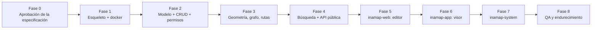

| Fase | Entregables | Criterio de salida |
|---|---|---|
| 0 | Este documento aprobado; supuestos S1–S7 resueltos | Firma del responsable de producto |
| 1 | Repo `inamap-backend-domain` con provider y cargadores; `.env.inamap*`; watcher; `pnpm dash:start inamap local` | Stack arriba; `--testsuite Core` verde; otros stacks intactos |
| 2 | Migraciones, modelos, CRUD de 8 entidades, permisos y seeders, límites de plan | Pruebas CRUD y de aislamiento verdes |
| 3 | `PolygonService`, `PathGraphBuilder`, `RouteService`, `EndpointResolver`, diagnóstico, guardado atómico | Pruebas unitarias de geometría y rutas verdes |
| 4 | Búsqueda difusa, API pública, QR, throttle, CORS | Pruebas de API pública y de no-fuga verdes |
| 5 | Paquete `im-maps`, app `inamap-web`: registro, mapas, editor, publicación | HU-EDI-* y HU-TEN-* verificadas |
| 6 | Paquete `im-viewer`, app `inamap-app` | HU-VIS-* verificadas en móvil |
| 7 | App `inamap-system` | HU-SYS-* verificadas |
| 8 | Rendimiento, accesibilidad, revisión de seguridad, documentación final | RNF-01…RNF-12 cumplidos |

## 10.6 Verificación end-to-end previa al cierre de cada fase

1. `pnpm dash:start inamap local`; `docker compose --env-file .env.inamap ps` saludable; `kitchntabs` y `vanexa` siguen arrancando (sin choque de puertos).
2. `docker compose --env-file .env.inamap exec app php artisan test --testsuite=Domain` y `--testsuite=Core`.
3. Mapa semilla de pruebas: 2 layouts, 1 camino de sentido único, 1 ascensor, ≥ 10 ubicaciones; `curl` a `search` y `route` y verificación de sentido y de tramo entre pisos.
4. Prueba manual de permisos con cada rol; IDs de otro tenant → 403/404.
5. Frontend: `tsc --noEmit` en `im-viewer`, `im-maps` y las tres apps; recorrido manual de FL-01…FL-05.

---

# Anexo A — Glosario

| Término | Definición |
|---|---|
| **Mapa** | Raíz del modelo de INAMAP: un recinto con su sistema de coordenadas (equivalente conceptual a `LabProject` en VaneXa). |
| **Layout** | Una planta/piso del mapa con su imagen de fondo y dimensiones en metros. |
| **Zona** | Polígono abstracto sobre el layout; no se solapa con otras zonas. |
| **Estructura** | Polígono sólido (edificio, pabellón) que puede contener ubicaciones. |
| **Ubicación** | Punto con metadata, categoría, términos y QR. |
| **Camino** | Polilínea dirigida; nodo del grafo de rutas. |
| **Enlace** | Conexión explícita entre caminos (misma planta o vertical entre plantas). |
| **Grafo de rutas** | Estructura derivada de caminos y enlaces sobre la que corre Dijkstra. |
| **Tenancy / Tenant** | Cuenta/organización (suscripción) y unidad operativa dentro de ella. |
| **Core / Dominio** | `dash-backend` (plataforma) / `inamap-backend-domain` (negocio). |

# Anexo B — Referencias

- `dash-backend-docker/docs/dash-backend.md`, `solution-architecture.md`, `QUICK_COMMANDS.md`
- Skills: `dashadmin-architecture`, `dashadmin-permissions`, `dashadmin-forms`, `dashadmin-images`, `dashadmin-i18n`, `dash-admin-envs-constants`, `frontend-new-package`, `frontend-architecture`
